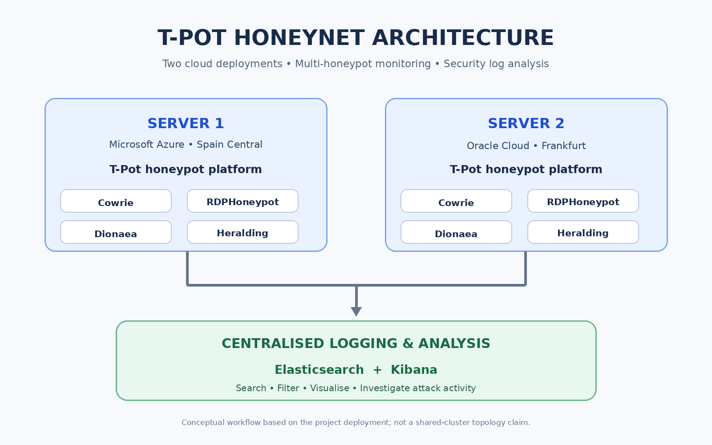

# T-Pot: Analysis of Attacks from Two Cloud Honeypots

**Author:** Dangeti Bhanu Sai Teja  
**Institution:** Technological University Dublin (TU Dublin)  
**Programme:** MSc Applied Cybersecurity  
**Project period:** September–October 2026  
**Project type:** Academic network security project

## Project overview

This project investigated cyberattack activity recorded by two cloud-hosted T-Pot honeynet deployments. The aim was to observe how exposed network services were probed and interacted with, then analyse the resulting security events.

The investigation used the T-Pot dashboard and Kibana/Elasticsearch data to examine activity recorded by Cowrie, RDPHoneypot, Dionaea and Heralding.

## Cloud infrastructure

| Deployment | Cloud provider | Region | Operating system |
|---|---|---|---|
| Server 1 | Microsoft Azure | Spain Central | Ubuntu Server 24.04 LTS |
| Server 2 | Oracle Cloud | Frankfurt | Ubuntu (upgraded during the project) |

The deployments had different observation windows and configurations. They are therefore treated as separate observations, not as a controlled comparison of cloud regions.

## Architecture

The diagram is a conceptual overview of the project workflow. It does not claim that both servers shared one Elasticsearch cluster.

## Honeypots investigated

| Honeypot | Investigation focus |
|---|---|
| Cowrie | SSH/Telnet interactions, commands and file-download events |
| RDPHoneypot | Remote Desktop connection and authentication attempts |
| Dionaea | Connections to emulated services, including SMB activity on destination port 445 |
| Heralding | Credential submissions, including PostgreSQL attempts |

## Selected findings

The following figures are document/event counts from the analysed datasets, not counts of unique attackers:

- **Server 2 dashboard:** approximately 2 million events displayed during the observation period.
- **Cowrie (Server 2):** 232,184 documents, including 111 successful file-download events and 97 unsuccessful download events. The investigation identified 17 unique SHA-256 hashes.
- **RDPHoneypot (Server 2):** 893,543 documents. One source generated 212,529 documents during the analysed period.
- **Dionaea (Server 2):** 135,812 documents matched the destination-port-445 filter.
- **Heralding (Server 2):** 228,204 documents overall; the PostgreSQL filter returned 696 documents.

The evidence showed probing, authentication attempts and payload retrieval behaviour. It did not establish compromise of a production system. GeoIP values are approximate source-IP geolocation and do not prove an operator's physical location.

## Tools and technologies

T-Pot · Cowrie · RDPHoneypot · Dionaea · Heralding · Kibana · Elasticsearch · Microsoft Azure · Oracle Cloud · Ubuntu Server

## Repository contents

- `screenshots/` — selected project dashboard and analysis screenshots. Detailed event areas have been obscured in these portfolio copies.
- `diagrams/` — high-level honeynet architecture diagram.
- `reports/` — instructions for adding a report version cleared for public sharing.
- `methodology.md` — summary of the investigation workflow.
- `.gitignore` — excludes common secrets, local configuration and raw log/capture files.

## Skills demonstrated

Network security · Honeypot deployment · Threat monitoring · Security log analysis · Kibana · Elasticsearch · Cloud infrastructure · Technical reporting

## Scope and limitations

- The two deployments had different observation windows and infrastructure configurations.
- Elasticsearch document totals are not unique attacker counts.
- Honeypot interactions do not, by themselves, prove compromise of a real production system.
- GeoIP results can reflect cloud hosts, VPNs, proxies or compromised devices.
- This repository is a portfolio summary, not a complete, reproducible T-Pot deployment package. Deployment scripts, raw logs and private infrastructure configuration are not included.

## Disclaimer and safe publication

This project was conducted for educational and cybersecurity research purposes using honeypot environments. The repository does not include raw honeypot logs, malware samples, credentials, private keys or cloud access details.

Before making the repository public, review every file for student identifiers, personal information, source and server IP addresses, credentials, API keys, tokens, private keys and other sensitive details. Confirm that sharing any academic report or screenshots is permitted by TU Dublin. Do not use honeypot findings to identify or contact source operators.

## Author

**Dangeti Bhanu Sai Teja**  
MSc Applied Cybersecurity, TU Dublin
